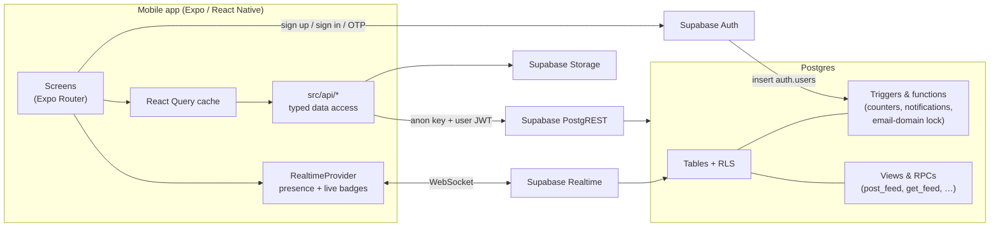
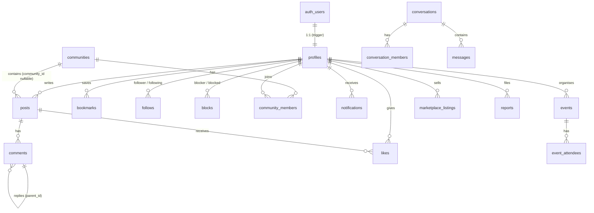

# OurBeckett architecture

This document explains how the app is put together, so new team members can find their way around and extend it safely.

## Overview



**Key principle:** the app is a thin client. Every security decision is made in Postgres:

- Row Level Security decides who can read or write each row.
- Column privileges decide which fields a client can set.
- Triggers maintain derived data such as counters, hashtags and notifications.

A modified or malicious client can't bypass any of this. The app only ever holds the public anon key.

## Tech stack and dependencies

| Package | Purpose |
|---|---|
| `expo` (SDK 58), `react-native` 0.88, `react` 19.3 | App runtime |
| `expo-router` | File-based navigation, protected route groups, deep links (`ourbeckett://`) |
| `@supabase/supabase-js` | Auth, database (PostgREST), storage and realtime client |
| `@react-native-async-storage/async-storage` | Persists the Supabase session and theme choice |
| `react-native-url-polyfill` | URL support required by supabase-js on React Native |
| `@tanstack/react-query` | Server-state cache, infinite scrolling, refetch on focus, invalidation |
| `expo-image` | Fast cached images (feeds, avatars) |
| `expo-image-picker` | Photo, video and camera selection |
| `expo-video` | Inline video playback |
| `expo-linear-gradient` | Brand gradients |
| `expo-haptics` | Tactile feedback on likes, tabs and buttons |
| `@react-native-community/datetimepicker` | Event date and time selection |
| `@expo/vector-icons`, `expo-font` | Ionicons |
| `expo-splash-screen`, `expo-status-bar`, `expo-system-ui`, `expo-constants`, `expo-linking` | Platform plumbing |
| `@electric-sql/pglite` (dev only) | In-memory Postgres for `npm run test:db` |

## Folder structure

```
app/                          Expo Router routes (each file is a screen)
  _layout.tsx                 Providers + auth gate (Stack.Protected groups)
  onboarding.tsx              Profile setup after first verification
  (auth)/                     Signed-out stack
    welcome, sign-up, verify, sign-in, forgot-password
  (app)/                      Signed-in stack
    (tabs)/                   Bottom tabs: index (Home), explore, new (Create), messages, profile
    create/                   Modals: index (chooser), post, event, listing, community
    post/[id]                 Post detail + comments
    user/[username]           Student profile
    follows/[id]              Followers / following
    chat/[id]                 Conversation
    new-message               Start a DM
    notifications, search, bookmarks, settings, edit-profile, change-password, blocked
    communities/, community/[id], community-members/[id]
    events/, event/[id]
    marketplace/, listing/[id]
    hashtag/[tag], feed/[mode]
src/
  api/                        One module per domain; all Supabase calls live here
  components/                 Feature components (PostCard, PostList, ProfileView, TabBar, …)
    ui/                       Design-system primitives (AppText, Button, TextField, Avatar, …)
  hooks/                      useModeration (report, block, start chat), useDebounced
  lib/                        supabase client, validation, media upload, time formatting, constants
  providers/                  Auth, Query, Realtime (presence + badges), Overlay (sheets + toasts)
  theme/                      Colour palettes (light/dark), tokens, ThemeProvider
  types/                      Domain types
supabase/
  migrations/                 SQL, applied in filename order
  tests/security.test.mjs     Database behaviour tests (npm run test:db)
```

### Conventions

- **Screens stay thin.** Data access goes through `src/api/*`. Server state goes through React Query, using the keys in `src/api/keys.ts`.
- **Shared key prefix for posts.** Every list of posts uses a key starting with `'posts'`, so one invalidation refreshes every feed after a create or delete.
- **Shared primitives.** UI uses the components in `src/components/ui` and colours from `useTheme()`. Nothing hard-codes light-only colours.
- **Consistent states.** Every screen renders explicit loading, empty and error states using `LoadingState`, `EmptyState` and `ErrorState`.

## Navigation and auth gate

`app/_layout.tsx` renders three protected groups:

| Group | Shown when |
|---|---|
| `(auth)` | There is no session, or a password recovery is in progress |
| `onboarding` | Signed in, but `profiles.onboarded = false` |
| `(app)` | Signed in and onboarded |

Because the guards are declarative, sign-in, sign-out, verification and onboarding completion route the user automatically, with no manual redirects.

The **Create** tab is a placeholder route. The custom `TabBar` intercepts it and opens the `/create` modal.

## Database design

### Entity relationships



### Tables

| Table | Notes |
|---|---|
| `profiles` | PK = `auth.users.id`. Unique lowercase `username`. No email column, so emails can never leak through the API. Denormalised `followers_count`, `following_count` and `posts_count`. |
| `posts` | Home and community posts share one table, with nullable `community_id`. `media_urls[]` holds up to 4 images or 1 video. `hashtags[]` is derived by trigger. Denormalised like, comment and share counts. |
| `community_posts` | View over `posts` where `community_id` is set. Likes, comments, bookmarks, search and reports therefore work identically for community posts. |
| `comments` | `parent_id` for replies. Replies are flattened to one level by trigger, Instagram-style. |
| `likes`, `bookmarks`, `follows`, `blocks` | Composite primary keys, which prevent duplicates. Self-follow and self-block are rejected by check constraints. |
| `communities`, `community_members` | `role` is one of `owner`, `moderator`, `member` or `banned`. The creator becomes owner by trigger. `member_count` excludes banned members. |
| `conversations`, `conversation_members`, `messages` | 1:1 DMs, created only through `get_or_create_dm()`, which also prevents duplicate threads. `last_read_at` powers read receipts and unread counts. |
| `notifications` | Created only by triggers: like, comment, reply, follow, message and event update. Unliking or unfollowing removes the notification. Messages keep one unread notification per conversation. |
| `events`, `event_attendees` | Category check constraint, `ends_at > starts_at`, denormalised `attendee_count`. |
| `marketplace_listings` | `price numeric(10,2)`, `listing_type` of sale, exchange or free (free implies £0), and `status` of available, reserved or sold. |
| `reports` | Write-only for students, who can read only their own. Unique per reporter and target. |

### Indexes

- Foreign-key and timeline indexes, such as `(author_id, created_at desc)` and `(conversation_id, created_at desc)`.
- Partial indexes, for example on unread notifications.
- GIN indexes on `hashtags` and `interests`.
- `pg_trgm` GIN indexes for search on usernames, display names, post bodies, community names, event titles and listing titles.

### Read models and RPCs

| Name | Kind | Purpose |
|---|---|---|
| `post_feed` | View (security invoker) | Post, author, community, `liked_by_me` and `bookmarked_by_me`, with blocked users hidden |
| `comment_feed`, `event_feed`, `listing_feed`, `community_feed` | Views | Equivalent enriched read models |
| `get_feed(mode, limit, offset)` | RPC | Feed modes `for_you`, `following`, `latest`, `trending` and `discussions` |
| `get_bookmarks`, `trending_hashtags`, `suggested_users` | RPCs | Saved posts, trending tags, and people with shared interests or the same course |
| `get_or_create_dm(other)`, `my_conversations()` | RPCs | Messaging |
| `username_available(name)` | RPC | Callable before sign-up; the only RPC open to anonymous users |

The `for_you` ranking scores engagement, then boosts posts from people you follow (×3), communities you're in (×2) and hashtags matching your interests (×1.5). It applies time decay of `(age_hours + 2)^1.4`.

## Security model

### Email-domain restriction (cannot be bypassed)

1. **Frontend:** `isStudentEmail()` gives instant feedback.
2. **Database (the guarantee):** a `BEFORE INSERT OR UPDATE` trigger on `auth.users` raises an exception unless the email matches `^[a-z0-9._%+-]+@student\.leedsbeckett\.ac\.uk$`, case-insensitive. It also blocks changing an existing account's email to another domain.

   Because the check runs inside Postgres, it covers every path into the system, including:
   - the mobile app
   - direct API calls with the anon key
   - dashboard invites
   - any provider accidentally enabled
3. **Optional Auth hook:** `hook_before_user_created` returns a friendly 403 before the insert is even attempted.

### Row Level Security

RLS is enabled on every table. Anonymous users are revoked from all tables. The table below summarises the rules:

| Data | Read | Write |
|---|---|---|
| Profiles, posts, comments, communities, events, listings | Any signed-in student | Owner only (`auth.uid()` checks) |
| Community posts | Any signed-in student | Members to create. Owners and moderators can delete. Banned members cannot post or comment. |
| Conversations, messages, conversation members | Participants only | Participants only, and only as themselves. Blocked pairs cannot message. |
| Notifications, bookmarks, block lists, reports | Owner only | Owner only |

Two more rules sit outside the table:

- **Blocking** hides each user's posts, comments, events and listings from the other through the views. Nobody can see who has blocked them.
- **Column privileges** stop clients setting counters, hashtags, roles, `is_official`, `created_at` or report status. For example, `update(body)` is the only update allowed on `posts`. Attempting anything else returns *permission denied*.

### Storage

| Bucket | Access |
|---|---|
| `avatars`, `media` | Public read using unguessable UUID paths, with no list permission. Students can write only inside their own `<user-id>/` folder. |
| `chat` | Private. Path is `<conversation-id>/<file>`. Only the two participants can upload or read, using 1-hour signed URLs. |

## Realtime

| Channel | Used for |
|---|---|
| `presence:online` | Presence. Each signed-in client tracks itself, which drives green online dots. `profiles.last_seen_at` is updated every 60 seconds for "Active 5m ago". |
| `user-stream:<uid>` | Postgres changes on `notifications`, `messages` and `conversation_members`, which keep the bell and Messages badges live. RLS filters rows per user. |
| `chat:<conversation-id>` | New messages, read-receipt updates on `conversation_members`, and a `typing` broadcast. |

Messages are sent optimistically with a client-generated UUID. The realtime echo with the same id replaces the pending bubble, so nothing is duplicated.

## Scaling notes

The design targets thousands of students on a single Supabase project:

- **Cheap counters.** Counts are denormalised and kept up to date by triggers, so feeds never run `count(*)`.
- **Indexed queries.** Every list query is index-backed. Feeds are paginated at 15 posts per page.
- **Bounded ranking cost.** `for_you` and `trending` only consider recent windows of 60 and 7 days, so cost stays flat as history grows.
- **Light client.** React Query caches aggressively, with a 30-second stale time and refetch on focus. Images are cached on disk by `expo-image`.

Next steps if the user base grows:

- Move feeds to cursor (keyset) pagination.
- Precompute `for_you` scores in a materialised view refreshed by `pg_cron`.
- Scope presence to conversation partners instead of one global channel.
- Add a CDN image transformation for thumbnails.
